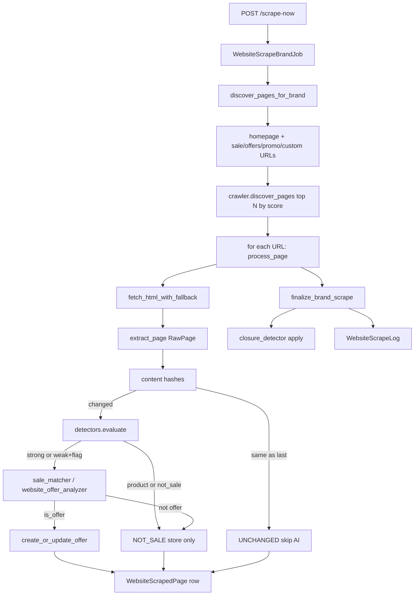

# How the website scraper works

There are **two** scraper trees. Only one runs in the app.

| Path | Role |
|------|------|
| [`services/website_scraper/`](services/website_scraper/) | **Production** — creates `Offer` rows with `source="website"` |
| [`website_scraper/`](website_scraper/) | **Research lab only** — tests fetch engines against storefronts; not wired to API/DB/jobs ([README](website_scraper/README.md)) |

---

## Trigger

Scrapes are **on-demand**, not on the scheduler.

1. Admin calls `POST /api/website-scraper/scrape-now` ([`app/api/routers/website_scraper.py`](app/api/routers/website_scraper.py))
2. That starts a `website_scrape_brand` background job ([`services/jobs/website_scrape_brand.py`](services/jobs/website_scrape_brand.py))
3. The job calls [`services/website_scraper/services.py`](services/website_scraper/services.py)

Per-brand gate: `Brand.website_scraping_enabled`. Config knobs live in [`config.py`](config.py) (`WEBSITE_SCRAPE_MAX_PAGES` default 8, delay, timeout, AI-on-weak-signal, closure thresholds).

---

## End-to-end flow (one brand)

### 1. Discover pages

[`crawler.discover_pages`](services/website_scraper/crawler.py) builds:

1. **Homepage** (fetched once)
2. **All DB promo URLs** — `sale_page_url` / `offers_page_url` / `promotions_page_url` / `custom_scrape_urls` (always kept)
3. **Top 5** nav/footer + sale-like links from the homepage (`WEBSITE_SCRAPE_TOP_DISCOVERED_LINKS`)

Product PDPs are skipped in the top-5 list (they never become offers anyway).

### 1b. Homepage hero OCR

On `page_type=homepage`, [`process_page`](services/website_scraper/services.py) OCRs hero/banner images via existing [`ai/ocr.py`](ai/ocr.py) and folds text into the page before rule-score / AI — same offer path as HTML.

### 2. Fetch HTML

[`fetch_html_with_fallback`](services/website_scraper/crawler.py):

1. HTTPX (fast)
2. Playwright Chromium if blocked
3. Camoufox if still WAF/Akamai-blocked

Statuses map to `ERROR` / `BLOCKED` and are still saved as page rows.

### 3. Extract → hash → rule-score

- [`extractor.extract_page`](services/website_scraper/extractor.py) → `RawPage` (title, body, prices, discounts, coupons, JSON-LD, product cards)
- [`normalizer`](services/website_scraper/normalizer.py) hashes; identical normalized hash → **UNCHANGED** (skip AI)
- [`detectors.evaluate`](services/website_scraper/detectors.py) → 0–100 score: `not_sale` / `weak` / `strong`

### 4. AI gate (optional)

Only non-product pages with strong signal (or weak if `WEBSITE_SCRAPE_AI_ON_WEAK_SIGNAL`) call:

[`sale_matcher.analyze`](services/website_scraper/sale_matcher.py) → [`ai/website_offer_analyzer.py`](ai/website_offer_analyzer.py)

Compact payload only (signals, prices, codes, truncated text) — not full HTML. Returns `is_offer` plus title, discount, coupon, dates, etc.

### 5. Create / update Offer

[`offer_processor.create_or_update_offer`](services/website_scraper/offer_processor.py) with dedup ([`deduplicator`](services/website_scraper/deduplicator.py)): same URL, then similar title/discount on the brand. Offer gets `source="website"`.

### 6. Finalize brand

[`finalize_brand_scrape`](services/website_scraper/services.py):

- [`closure_detector`](services/website_scraper/closure_detector.py): if an open website offer’s URL no longer shows the sale across consecutive successful scrapes → POSSIBLY_ENDED → EXPIRED
- Upsert [`WebsiteScrapeLog`](database/models.py) counts/timestamps

Every attempt also writes a [`WebsiteScrapedPage`](database/models.py) row (`NEW`, `UPDATED`, `UNCHANGED`, `SALE_DETECTED`, `NOT_SALE`, `ERROR`, `BLOCKED`).

---

## What you can inspect in the UI/API

- Brand config (URLs + enable flag)
- Pages / history / offers for a brand
- Job pages + activity feed
- Reprocess (refetch) or reanalyze (AI only on stored extract)
- Manual close on a website offer

---

## Research lab vs production

The root [`website_scraper/`](website_scraper/) folder runs standalone scrapers (`httpx_selectolax`, Playwright, Camoufox, Scrapy, Scrapling) and dumps JSON under `payloads/`. Sale detection there is keyword/price only. Production reused the validated fetch/extract ideas inside `services/website_scraper/` but does **not** import that package.
